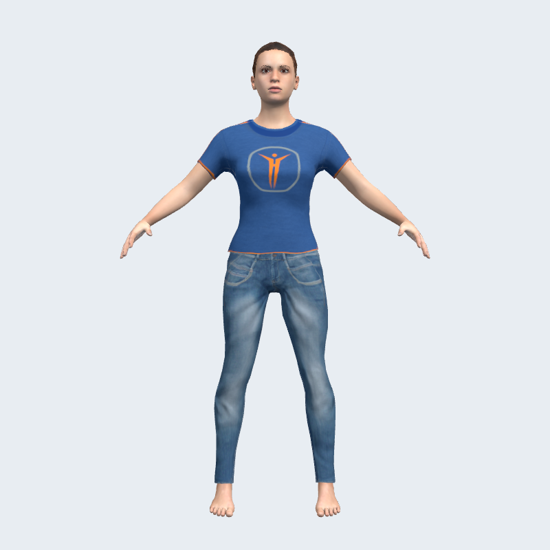
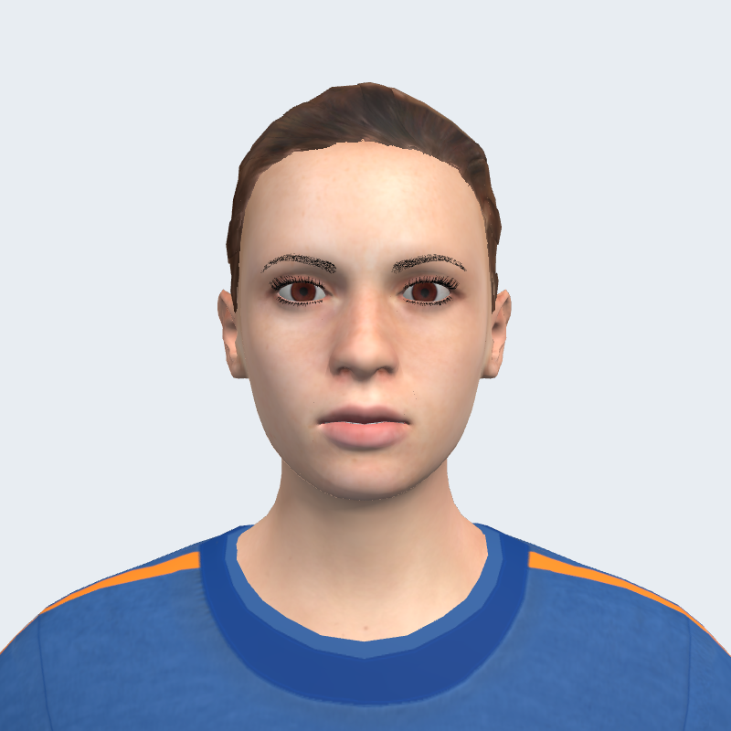
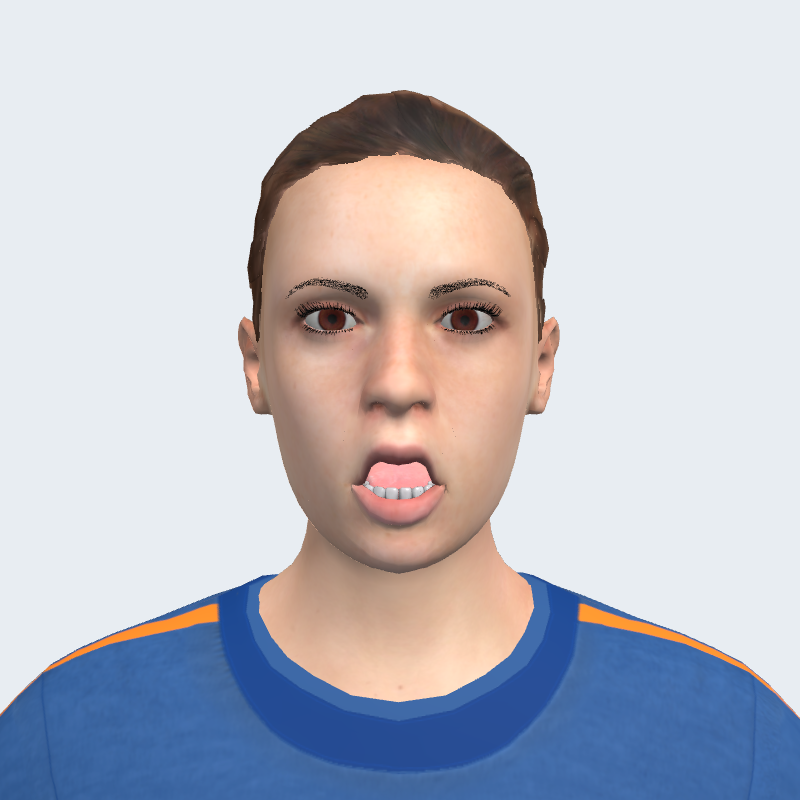
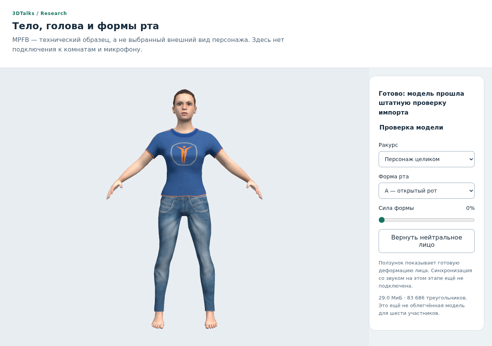
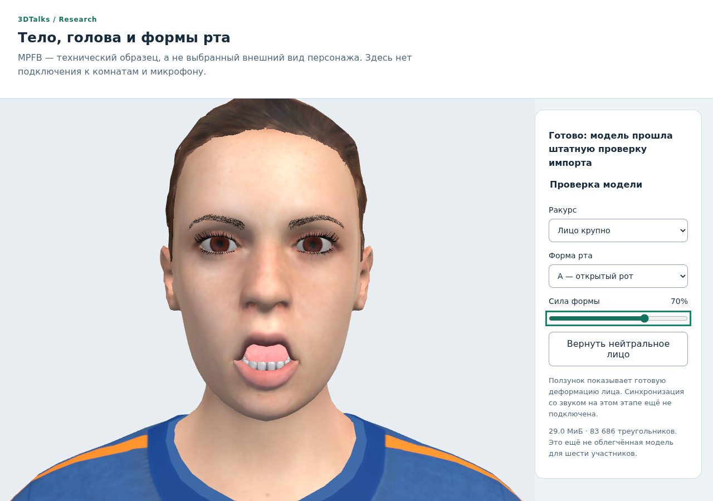
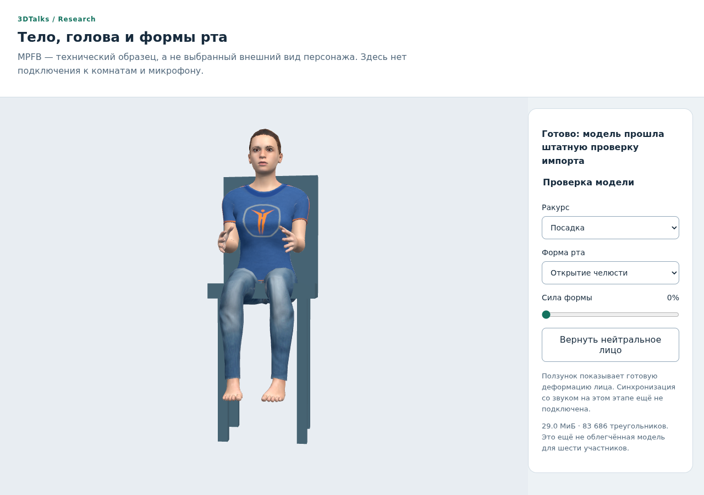
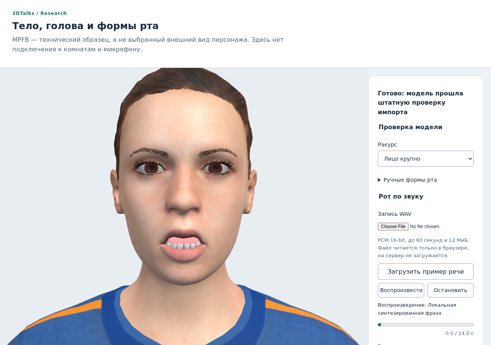

# Аватар и анимация рта: исследование для 3DTalks

Дата: 21 октября 2026. Ветка: codex/avatar-lipsync-research от d9efb866.
Статус: стенд и интеграция RMS-анимации с воспроизведением голоса переговорной.
Человеческие модели-кандидаты подготовлены; стандарт аккаунта ещё не заменён.
Фонетический lip-sync не внедрён. Комплект и проверка: docs/research/avatar-lipsync/MEETING_HUMAN_V1.md.
Продолжение: MEETING_AVATAR_INTEGRATION.md, codex/meeting-avatar-integration.
Продолжение с фактической проверкой файлов и подготовкой — раздел 11.
Пользователь выбрал стилизованного человека без сильной мультяшности.
Дальнейшие этапы звука/LiveKit/WebRTC отложены. Сервер этой задачей не меняется.
В исходную точку входит ещё не развёрнутая правка названий вкладок d9efb866.

## 1. Главный вывод

Нужно разделить два решения: как деформировать лицо и откуда получать сигнал.
Для нашего клиента рекомендуются morph targets (готовые формы рта) в GLB.
Сначала сделать управляемое звуком открывание рта, затем сравнить его с
распознаванием визем. Это разные уровни качества, а не два названия одной вещи.
Нельзя обещать точную артикуляцию по одному уровню громкости.

Для первого технического стенда найден и проверен CC0 MPFB из TalkingHead.
Это эталон работоспособного лица, а не согласованный внешний вид продукта:
по просмотру он ближе к реалистичному человеку, чем к выбранному стилю.
Для внешнего вида ближе Quaternius Universal Base Characters; после проверки
бесплатного Standard подтверждено отсутствие форм губ и кости челюсти.
Итоговую модель нельзя назначить стандартной до визуального выбора и проверки лица.

## 2. Что у нас сейчас

- public/js/avatarBase.js: геометрические голова/тело; анатомического рта нет.
- userAvatarRenderer.js поддерживает full body GLB либо стандартное тело с головой.
- avatarValidation.js: body до 40 МиБ/100 000 треугольников, head до 20 МиБ/
  30 000 треугольников. Это текущие верхние границы, не целевой бюджет качества.
- Отдельная head-модель не может иметь skin: HEAD_MUST_BE_STATIC. Morph targets
  без skin не запрещены как класс, но лицо со скелетом челюсти сюда не подходит.
- Полное тело должно иметь распознаваемую иерархию hips/head/ног и общий скелет.
- Импорт не принимает sparse accessors, внешние ресурсы и ряд расширений сжатия.
- RoomSeatAvatar.apply восстанавливает rest-кватернионы костей перед посадкой.
  Движение челюсти через bone надо выполнять после него; иначе оно будет стёрто.
- voiceChat.js принимает завершённый клип, декодирует AudioBuffer, создаёт
  AudioBufferSourceNode и запускает source.start(). Это не потоковый разговор.
  Собственные сообщения не воспроизводятся самому отправителю.
- Уже есть отдельные события фактического playback и recording. VOICE_START
  означает запись сообщения; он не должен запускать рот удалённого персонажа.

## 3. Что считать анимацией

| Уровень | Что видит человек | Ограничение |
|---|---|---|
| Индикатор | Значок/подсветка участника | Не анимация лица |
| Цикл открывания | Один заготовленный клип на весь звук | Двигается в паузах, выглядит механически |
| Реакция на сигнал | Открывание рта пропорционально энергии, закрытие в тишине | Показывает речь, но не произносит конкретные звуки |
| Виземы | Меняются формы губ для групп звуков, например А/О/М | Нужен классификатор/разметка и соответствующие формы модели |
| Полная мимика | Губы, щёки, глаза, эмоции, движения головы | Самостоятельная большая задача, часто нужен трекинг/ML |

MVP должен честно называться анимацией рта по звуку. Полный lip-sync требует
проверки того, что формы меняются сообразно звукам, а не только открываются.

## 4. Как деформировать лицо

| Метод | Плюсы | Минусы | Решение |
|---|---|---|---|
| Morph targets / blend shapes / shape keys | Естественные заранее подготовленные формы, смешивание, обычный GLB/Three.js | Нужны формы в исходной модели, расход GPU-памяти | Основной вариант |
| Кость jaw | Дёшево открывает нижнюю челюсть | Не даёт полноценные губы; конфликт с нашим reset костей | Допустимый запасной вариант для подходящей модели |
| Смена текстуры/2D-рот | Просто для нынешних примитивов | Плоско сбоку, другая эстетика | Только осознанный упрощённый стиль |
| Ручное движение вершин | Можно менять произвольную сетку | Нет семантики лица, риск порвать губы/зубы | Не брать для первой версии |
| Видео/нейрорендер головы | Может выглядеть убедительно в отдельном кадре | Не готовая сидящая 3D-модель, сервер/GPU/задержка | Вне задачи |

Наличие AnimationClip walk/idle в файле не означает наличие работающего рта.
Риг тела тоже не гарантирует лицевой риг. У модели должны быть внутренняя
полость рта, корректные губы, а при наличии зубов/языка — согласованное движение.

## 5. Откуда брать сигнал

### Рекомендуемый первый вариант: огибающая AudioBuffer

Из уже декодированного клипа получить огибающую RMS небольшими окнами,
например 20 мс; стерео оценивать по энергии обоих каналов без взаимного
погашения при противофазе. Включить порог тишины, ограничение открытия и
сглаживание с разной скоростью открытия/закрытия. Начальные параметры —
предмет настройки по записям, а не обещанные показатели качества.

Зафиксировать время source.start(t0); читать огибающую по часам AudioContext,
а не Date.now/setInterval. При suspension часы аудио останавливаются; кадр
не должен уводить рот вперёд. Отмена source/смена epoch/выход закрывают рот.
Для будущего streaming источник анализа можно заменить AnalyserNode/worklet,
не переписывая интерфейс применения форм лица.

Это проектное предложение на основе текущего кода; ещё не измерялось.
Для 60-секундного клипа 50 отсчётов/с дают около 3000 float значений, примерно
12 КБ на огибающую. Это не бюджет исходного AudioBuffer, который значительно
больше. Исходные PCM-копии не хранить дольше самого воспроизведения.

### Спектральная оценка визем: отдельный эксперимент

[HeadAudio](https://github.com/met4citizen/HeadAudio) — самостоятельный MIT
AudioWorklet с классификацией звука в формы рта. Можно испытать без внедрения
всего TalkingHead и без отправки записей во внешний сервис. Сам автор отмечает
ошибки VAD/классификации; опубликованные задержки/скорость не являются нашими
измерениями. Модель обучения с английским именем не доказывает качество русского.
Оценивать на русской речи, шёпоте, тишине, шуме и нескольких голосах.

### Предварительная разметка и TTS

[Rhubarb](https://github.com/DanielSWolf/rhubarb-lip-sync) получает тайминг
форм рта из готовых записей; для неанглийской речи имеет phonetic recognizer.
Это кандидат для офлайн-роликов, но дополнительная обработка каждого сообщения
ухудшит нынешнюю задержку. Сначала измерить, а не ставить на VPS автоматически.
TTS с готовыми виземами подходит синтезированному голосу, но не заменяет
анализ настоящей пользовательской речи. Транскрипция/LLM ради MVP не нужны.

## 6. Точная семантика для комнаты

1. Удалённый рот двигается во время фактического воспроизведения этого
   участника в данном браузере. При нынешнем транспорте это позже записи.
2. Для себя возможен отдельный локальный preview от существующего capture;
   не открывать второй микрофон и не выдавать preview за услышанное другими.
3. Кнопка проверки микрофона остаётся локальной проверкой, без трансляции
   мимики другим. Анимация не должна зависеть от VOICE_START/END как от аудио.
4. При app mute/skip по расстоянию/неуспешном decode/запрете autoplay рот
   не продолжает разговор. Аппаратную громкость системы браузер достоверно
   не знает, поэтому её нельзя обещать учитывать.
5. Обрабатывать исходящие source.onended, stop, close, disconnect, room end,
   замену/удаление аватара и запоздалые async-ответы. Reset идемпотентен.
6. Разные авторы и источники принадлежат разным сессиям; один завершённый
   клип не обнуляет другой активный клип. На одного участника композиция
   источников должна быть явной и ограниченной, без независимых таймеров.
7. Не смешивать всех участников в один analyser: иначе все рты двигаются одинаково.
8. Управлять только mouth-каналами, не стирать blink/emotion. Один кадр
   MeetingFrame, без дополнительного renderer/rAF на каждого персонажа.
9. Кешировать индексы morphTargetDictionary при загрузке, не обходить сцену
   каждый кадр. Состояние weights отдельно для каждого экземпляра аватара.
10. Новые аудио-пакеты и частая передача morph weights через WS для первой
    версии не требуются: анимируем по тому же полученному аудио на каждом клиенте.
    Микропозы между браузерами могут отличаться, но совпадать с локальным звуком.

## 7. Найденные модели и честный статус проверки

| Кандидат | Что подтверждено | Что остаётся |
|---|---|---|
| [Quaternius Universal Base Characters](https://quaternius.itch.io/universal-base-characters) | Standard скачан, CC0 подтверждена внутри; два Superhero, morphs/jaw отсутствуют | Лицо надо дорабатывать; Regular в этом бесплатном архиве нет |
| [MPFB GLB из TalkingHead](https://github.com/met4citizen/TalkingHead/blob/2afe6d79779313db8909badebf46f9805a6c7b70/avatars/mpfb.glb) | Конкретный файл скачан, разобран, отрисован нашим loader; формы рта движутся; автор указывает CC0 | Тяжёлый/ближе к реалистичному; исходник не проходит текущую валидацию |
| [Microsoft Rocketbox](https://github.com/microsoft/Microsoft-Rocketbox) | Официально MIT, humanoid и лицевые варианты; нужно сохранить copyright/лицензию | FBX, конвертация/материалы/конкретный лицевой вариант не проверены, эстетика более реалистичная |
| [VRoid presets](https://vroid.pixiv.help/hc/en-us/articles/4402394424089-VRoidPreset-A-Z) | Есть стандарт лица VRM, официальные отдельные условия образцов | Образцы не CC0; anime-эстетика, VRM-расширения и условия не лучший старт |
| [TalkingHead brunette](https://github.com/met4citizen/TalkingHead#credits) | В credits указано CC BY-NC для образца | Для коммерческой базы не выбираем; MIT библиотеки не лицензирует все её модели |

[Официальная страница Quaternius](https://quaternius.com/packs/universalbasecharacters.html)
описывает разные пропорции и средние 13k tris. На itch free Standard и платный
Source — разные комплекты. Наличие модели на красивой картинке не доказывает
её наличие в бесплатном архиве. Для выбранного стиля сначала смотреть Regular,
а не автоматически брать Superhero; не покупать Source без решения пользователя.

### Фактический осмотр MPFB

Закреплён источник TalkingHead 2afe6d79779313db8909badebf46f9805a6c7b70.
Файл: 36 815 920 байт (~35,1 МиБ), SHA-256
63c645a2a863b9972e9a9c2ed576a1de4c390b8475508e1473e69c87a3ee299c.
Из JSON GLB: 83 686 треугольников, 76 nodes, 1 skin, 8 материалов,
7 встроенных PNG, 287 sparse accessors. Геометрия бровей/ресниц даёт большой
вклад в полигонаж. Основная сетка имеет 66 morph targets, включая viseme_aa,
viseme_PP, jawOpen и другие; отдельные формы есть также у зубов и языка.

Наш inspectGlb(body) возвращает UNSUPPORTED_GLB: sparse accessors сейчас
запрещены. Это не повреждённый файл: GLTFLoader загрузил его без JS errors.
Нельзя ослаблять защиту импорта ради одного примера. Следующий опыт —
подготовленный экспорт и оптимизация с сохранением mouth shapes; после
уплотнения sparse размер и память могут вырасти, что тоже нужно измерить.

Тест только менял viseme_aa на 0.7 одновременно у подходящих мешей.
Это проверка формы, не доказательство синхронизации со звуком.
Посадка, 6 копий, анимация по голосу, мобильная скорость не проверялись.

Машиночитаемые результаты: [mpfb-inspection.json](docs/research/avatar-lipsync/mpfb-inspection.json).
Большой исходный GLB в Git/public/seeds не добавлен. Preview — наши рендеры
проверенного CC0-кандидата, не выбранная внешность стандартного персонажа.
Лицензия ассета проверяется отдельно от лицензии программы/библиотеки:
[MakeHuman/MPFB](https://static.makehumancommunity.org/about/license.html),
[credits конкретного GLB](https://github.com/met4citizen/TalkingHead/blob/2afe6d79779313db8909badebf46f9805a6c7b70/README.md#credits),
[Rocketbox MIT](https://github.com/microsoft/Microsoft-Rocketbox/blob/master/LICENSE.md).

## 8. Контракт модели и бюджет подготовки

Предлагаемый asset profile: один self-contained GLB 2.0, совместимый
humanoid rig, отдельно документированные mouth target names, нейтральное
состояние, закрытый рот при нулевых весах. Тело/голова в одном файле;
не соединять произвольную голову с чужим телом без подгонки шеи/skin/масштаба.

Для первой сборки целиться в 15–30k треугольников на человека, 4–8 материалов,
текстуры до 1–2k, файл по возможности до 10 МиБ. Это проектный ориентир,
не новый лимит API и не гарантия fps. Проверить 6 аватаров с офисом/экраном,
память texture/morph/skinning, draw calls и мобильный браузер. Не добавлять
Draco/Meshopt/KTX2 до согласованного совместимого профиля импорта.

MVP: качественный mouthOpen/viseme_aa и закрытое состояние; предпочтительно
дополнительно viseme_PP, E, I, O, U и остальные viseme shapes для следующего
уровня. 52 ARKit формы — полезный расширенный профиль, но не обязательное
условие простого открытия рта и не готовый звук→виземы алгоритм.

## 9. Предлагаемый порядок после этого исследования

1. Выбрать внешность: посмотреть Regular Quaternius и MPFB-референс;
   получить конкретный лицензированный исходник с рабочим лицом. При
   отсутствии mouth shapes потребуется их создание/художник, не случайный скрипт.
2. В изолированном локальном стенде проверить GLB/свет/рот/посадку. Подготовить
   и оптимизировать экспорт, пройти тот же серверный validator без обходов.
3. Сравнить на одном коротком аудио RMS→mouthOpen и audio→visemes, показать
   пользователю разницу. Движение от громкости не называть фонетическим lip-sync.
4. Только после выбора внедрять контроллер рта в существующий render/playback
   lifecycle; затем real microphone/два браузера/6 аватаров/mute/history cleanup.
5. Замена стандартного аватара, адаптация кабинета и раскатка на сервер —
   отдельные согласованные этапы. Старые пользовательские аватары сохраняются;
   несовместимая модель получает нейтральный рот/индикатор, а не ошибку комнаты.

Критерии будущей приёмки: рот закрыт в паузах, движение совпадает с локально
слышимым звуком, при mute/end/выходе исчезает, шесть лиц независимы, посадка
и обзор сохранены. Проверять русскую речь и шумы; численные задержки/CPU/fps
объявлять только после измерения. Голос не отправляется стороннему сервису.

## 10. Источники технологии

- [Web Audio API / AnalyserNode](https://www.w3.org/TR/webaudio/#AnalyserNode)
  — чтение временного/частотного сигнала; методы расчёта выше — наше предложение.
- [Three.js Mesh](https://threejs.org/docs/pages/Mesh.html)
  — morphTargetDictionary/morphTargetInfluences.
- [glTF 2.0](https://registry.khronos.org/glTF/specs/2.0/glTF-2.0.html)
  — skin/morph targets; сам GLB не определяет значение имён визем.
- [HeadAudio](https://github.com/met4citizen/HeadAudio) — кандидат для эксперимента.
- [Rhubarb Lip Sync](https://github.com/DanielSWolf/rhubarb-lip-sync)
  — предварительные mouth cues, phonetic recognizer для неанглийских записей.

Runtime, npm, SQL, Docker и VPS в исследовании не менялись. Push не выполнялся.
Предыдущие checkpoint-теги/ветки остаются на месте. Дальнейшая разработка
ожидает согласования следующего этапа.

## 11. Подготовленная модель и локальный просмотр

По следующему «продолжай» выполнен этап подготовки, без внедрения звука.

### Quaternius: проверен именно бесплатный архив

С официальной страницы получен free Standard без покупки Source. Архив
128 968 391 байт, SHA-256
fdbf1804c90dfc1ea03e992bff7da2dfd1a79318e13270a660180f9308455f40.
Внутренний License_Standard.txt подтверждает CC0; сохранён рядом с отчётом.
В Base Characters есть только Superhero Male/Female: по 69 nodes и одному
skin, но 0 morph targets и нет jaw/lip/mouth nodes. Это не готовые говорящие
лица. Пропорции Regular отсутствуют. Ни полный архив, ни эти модели в продукт
не добавлены. Источник — та же официальная страница автора из раздела 7.
Результаты: [quaternius-inspection.json](docs/research/avatar-lipsync/quaternius-inspection.json).

### MPFB: подготовлен совместимый экземпляр

Добавлен offline-инструмент scripts/prepare-avatar-lab-model.py. Он принимает
только закреплённый SHA исходного CC0-файла, не обслуживает HTTP-загрузки,
не перезаписывает исходник/существующий выходной путь. Он сохраняет только
viseme_*, jawOpen и eyeBlinkLeft/Right, уплотняет используемые sparse accessors,
исключает ненужные данные. Набор эмоций сокращён только у экспериментальной
копии. Тело, скелет, skinning, изображения и соответствующие им материалы
не заменялись. Готовый файл — 30 391 976 байт (~29,0 МиБ), SHA-256
 ee4fa598f58545c8afcaa10da5723681e706d546ac2d200ab2e48ce5e907b9b8.

Штатный inspectGlb(body) принимает результат: 83 686 треугольников,
распознанные Hips/Head/ноги/руки; sparse accessors — 0. Validator и его лимиты
не менялись. Никакой готовности к шести участникам это не доказывает:
полигонаж и текстуры ещё тяжёлые, а стиль остаётся техническим референсом.
Исходник и результат находятся вне Git, в локальном временном каталоге.

### Инструмент просмотра

scripts/avatar-lipsync-lab.js запускает readonly-сервер только на 127.0.0.1,
с фиксированным списком доступных файлов. Его нет в Express-маршрутах,
public HTML и рабочем запуске. tools/avatar-lipsync-lab содержит самостоятельный
интерфейс: тело, лицо, посадка, выбор А/О/М-П-Б/jawOpen, ползунок веса и reset.
Посадка использует настоящий RoomSeatAvatar, загрузка — UserAvatarRenderer.
Микрофон/аккаунты/API/передача голоса не подключены. Нет отдельного бесконечного
rAF: перерисовка по действию/resize; pagehide освобождает ресурсы и инвалидирует
ожидающую загрузку. Возврат из BFCache запускает чистую страницу.

[Запуск и повторение проверки](tools/avatar-lipsync-lab/README.md).
Локальный адрес в текущем сеансе: http://localhost:4187/.
Доступность из Windows подтверждена HTTP 200, а не только внутри WSL.

### Проверка

Новый test-avatar-lab-browser.js прошёл на настоящем Chromium/Three.js:
исходник независимо декодирован штатным GLTFLoader, с результатом подготовки
сравнены 53 116 вершин и 1 910 568 компонентов сохранённых morph-атрибутов
с допуском 1e-7. Проверены формы и нейтральное лицо, действительная supported
посадка, ширина 390 px, остановка, отсутствие запросов к API/внешним сервисам,
404 для незарегистрированного пути и 405 для POST. Снимки лица/посадки просмотрены.

[Профиль подготовленной копии](docs/research/avatar-lipsync/mpfb-lab-inspection.json).
Ещё не проверены: автоматический звук→рот, 6 моделей, реальные устройства,
профиль памяти/fps. Персонаж по умолчанию и пользовательские аватары не менялись.
Следующий этап после согласования — сравнение анимации по звуку в этом локальном
стенде. Ветка/сервер LiveKit остаются отложенными; push/VPS/Docker не выполнялись.

## 12. Анимация при локальном воспроизведении

По следующему запросу пользователя добавлен звук в изолированный стенд.
Продолжение LiveKit/звукового транспорта по-прежнему отложено. Уточнение
внешности для следующего подбора: мужчина нейтральной азиатской внешности,
стилизованный без сильной мультяшности. Возраст/одежда не заданы. Нынешний
MPFB остаётся техническим образцом; нельзя автоматически считать его финальным.

### Что сделано

- Загрузка WAV в браузере без HTTP POST и без обращения к микрофону.
  До выделения AudioBuffer проверяются RIFF/WAVE, PCM16, 1–2 канала,
  8–48 кГц, корректные размеры и длительность <=60 с, файл <=12 МиБ.
  MP3/OGG/float-WAV пока не поддерживаются.
- На одном клипе рассчитывается огибающая RMS по окнам около 20 мс,
  с порогом/гистерезисом тишины и сглаживанием открытия/закрытия. Стерео
  считается по энергии каналов: противофазная речь не гасится усреднением волн.
- Source запускается с t0=context.currentTime, вес viseme_aa читается по
  elapsed=context.currentTime-t0. Это не setInterval и не VOICE_START.
  При остановке часов/недоступном выводе рот не продолжает самостоятельный цикл.
- Только один source/rAF, ручное управление ртом временно блокируется.
  Частые кадры меняют кешированные morph weights и рисуют сцену; не обходят
  заново GLB для поиска форм и не пересчитывают посадку/камеру каждый кадр.
- Stop, onended, скрытие вкладки, смена файла и pagehide закрывают рот.
  Generation guards исключают запуск после позднего resume/чтения старого файла.
  Ошибки не оставляют открытый рот. Context закрывается при dispose.
- Есть прогресс и отдельный статус без объявления таймера screen reader на
  каждом кадре. Для manual shapes — раскрываемый блок; основные аудиокнопки
  доступны без необходимости раскрывать его.
- Необязательный server CLI demoPath включает readonly GET /demo.wav.
  В текущем локальном сеансе пример синтезирован на компьютере голосом
  Microsoft Pavel: русская фраза с явными паузами, около 14 секунд.
  Запись не добавлена в Git, не отправлялась внешнему сервису. Демонстрацию
  нужно загрузить кнопкой, затем отдельно запустить — autoplay отсутствует.

Это амплитудная анимация, а не классификация А/О/М по речи: в автоматическом
режиме используется viseme_aa. Музыка/громкие шумы тоже могут двигать рот.
Порог и времена сглаживания пока экспериментальные, качество под другие
микрофоны/шум не измерено. Системную аппаратную громкость браузер не знает.

### Проверка и границы

test-avatar-lab-audio.js прошёл: native AudioContext/source/output,
переход речь-пауза-речь (синтетический тестовый сигнал), окончание/stop,
поздний resume/файл, моделирование hidden и закрытие context. Также проверены
малый шум, стерео в противофазе и отказ на неподдерживаемых/повреждённых WAV.
Тестовый сигнал не является человеческой речью и не доказывает артикуляцию.

test-avatar-lab-browser.js повторно прошёл с настоящей моделью: во время
реального AudioBufferSource воспроизведения меняется morph формы А, после
окончания все управляемые веса равны нулю; ручные формы/посадка/мобильная
ширина/геометрическая эквивалентность сохранены. Отдельный smoke текущего
localhost проверил синтезированную русскую фразу: открывание, паузы, завершение,
нейтральный reset; ошибок JS нет. Screenshot просмотрен. Физический микрофон
и субъективная оценка услышанного человеком не тестировались.

Как открыть и запустить — [README стенда](tools/avatar-lipsync-lab/README.md).
Стенд по-прежнему на http://localhost:4187/. Рабочие комнаты, сервер/VPS,
WebRTC и стандартные аватары этим этапом не менялись. Push не выполнялся.
Следующий этап: показать разницу с виземами или перейти к подбору указанной
мужской внешности, сохранив требование готового лица и совместимой лицензии.

## 13. Запись собственного голоса в стенде

По следующему запросу пользователя основным сценарием стала запись микрофона:
«Записать с микрофона» → разрешить доступ → сказать фразу → «Завершить запись»
→ «Воспроизвести». Файлы и пример перенесены в закрытый дополнительный раздел.
MediaRecorder выбирает поддерживаемый браузером WebM/Opus, Ogg/Opus или MP4;
после завершения локальный decodeAudioData даёт PCM для прежней огибающей.
Рот управляется часами воспроизводящего AudioContext, без фонетического анализа.

Лимиты: 30 секунд, 12 МиБ, ожидание разрешения 15 секунд. Микрофон работает
только после явного действия на localhost/HTTPS. Запись хранится в памяти,
заменяется следующей и не отправляется серверу. Остановка, ошибка, hidden,
dispose и позднее разрешение закрывают дорожки; поздняя расшифровка PCM
не возвращает отменённую запись. При завершении захват выключается до декодирования.

Проверки test-avatar-lab-audio.js: настоящий getUserMedia/MediaRecorder с
синтетическим микрофоном Chromium, воспроизведение, открывание/закрывание рта,
отказ/повтор, позднее разрешение, лимит (ускоренный таймер только в тесте), hidden
и окончание дорожек. test-avatar-lab-browser.js проверяет те же кнопки с моделью,
изменение morph-весов и нейтральное лицо после воспроизведения. Физический
микрофон пользователя требует личной проверки. Комнаты и VPS не менялись.
